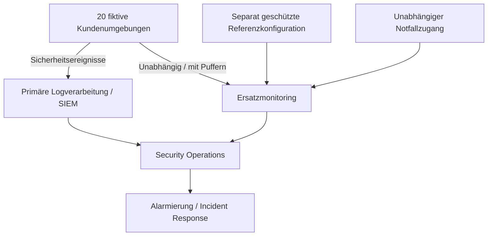

# Vereinfachte Zielarchitektur – konzeptionell

**Hinweis:** Die Grafik zeigt eine **Zielidee**, keine bereits implementierte Architektur. Die Unabhängigkeit der Netzwerkpfade, Logpuffer, Zugriffskontrollen, Konfigurationsquellen und Alarmierungswege ist **nicht geprüft**. Ein regelmäßiger Datenfluss zum Ersatzsystem allein garantiert weder echte Redundanz noch lückenloses Logging.
